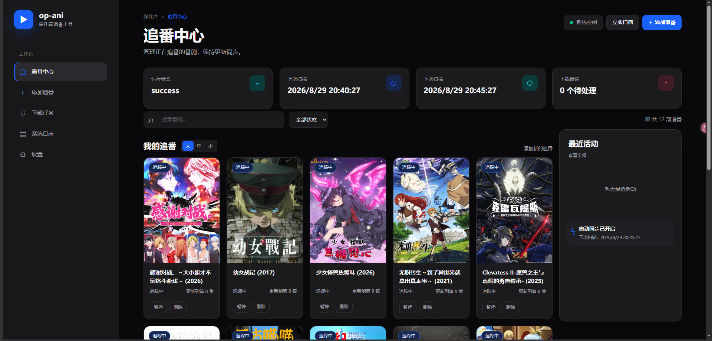
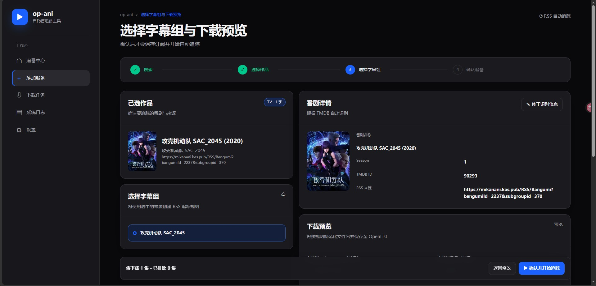

<p align="center">
  
</p>

<h1 align="center">OpenList-Ani · op-ani</h1>

<p align="center">
  <b>从找番、识别、过滤，到网盘下载和规范命名的一站式追番工具</b>
</p>

<p align="center">
  这是基于上游 OpenList-Ani 持续维护的个人整合版，重点服务于 OpenList + 迅雷/夸克等网盘 + SmartStrm + Jellyfin 的媒体库工作流。
</p>

<p align="center">
  当前默认 <code>master</code> 是 Rust 运行版本；原 Python 版本和它的 README 保留在 <a href="https://github.com/PainKiller0x0/Openlist-Ani/tree/python"><code>python</code> 分支</a>。
</p>

---

## 这是什么

op-ani 负责“发现资源”和“创建下载任务”，不负责保存媒体文件，也不是播放器。

它从 Mikan 或其他 RSS 获取更新，识别番剧信息，按规则过滤资源，经用户确认后交给 OpenList 离线下载，再按 Emby/Jellyfin 友好的格式整理名称和目录。

```text
Mikan / RSS
    ↓
op-ani：识别、TMDB 校验、过滤、最终命名与目录预览
    ↓
OpenList：创建离线下载任务并保存到目标网盘
    ↓
SmartStrm（可选）：把网盘文件生成 STRM
    ↓
Jellyfin / VidHub / 其他客户端播放
```

SmartStrm、Jellyfin 和播放器都不是 op-ani 的硬依赖。只使用 OpenList 下载时，op-ani 也可以单独运行。

## 我们这版做了什么

### 网页端追番入口

- 在首页通过 Mikan 搜索番剧、选择字幕组并构建 RSS，也可以直接添加 RSS。
- 订阅前预览 TMDB 识别、RSS 条目、排除结果、改名结果和完整下载目录。
- 订阅详情页可以查看命名/归档规则，并手动刷新 RSS 预览；预览不会创建下载任务。
- 确认后保存订阅并开始追踪；首页可查看进度并管理暂停、完结和删除。

### RSS 过滤与订阅管理

- 支持全局与单订阅排除规则，多个规则以 `|` 分隔。
- 显示条目数、排除数量以及符合当前规则的条目。
- 支持扫描、暂停/恢复、标记完结、修正 RSS 和删除订阅。
- 页面显示最近扫描、下一次扫描、最新处理集数和目标目录。

### TMDB 媒体识别与命名

- 从资源标题识别番剧、季集和字幕组信息，并通过 TMDB 校验作品身份。
- 可配置 OpenAI/Anthropic 兼容服务辅助解析；模型输出不会取代 TMDB 的作品身份校验。
- 文件名标题、文件名季号、归档季目录和集数偏移可以独立设置，适配特殊作品。
- 常见命名形式为 `番剧名 - S01E01`；预览会显示最终文件名主体和下载目录。

### OpenList 下载与任务恢复

- RSS 下载和网页上传 `.torrent` 均可交给 OpenList 处理。
- 跟踪持久化任务状态，支持受控恢复、失败任务归档和重试。
- 下载完成后按计划整理名称与目录；可选通知 SmartStrm 刷新媒体库。
- 当前 Rust 版本没有实现磁力链接 DHT 元数据解析；无法识别的任务会明确失败，不会伪造作品名。

## 部署与安全

Rust 服务沿用现有 TOML 配置和 SQLite 业务数据，保留旧表，并以独立持久化状态记录 Rust 下载操作。生产部署、服务切换和回滚流程见 [`rust/docs/DEPLOYMENT_RUNBOOK.md`](rust/docs/DEPLOYMENT_RUNBOOK.md)。

- 不要提交真实 `config.toml`、认证环境文件、API Key、机器人令牌、生产数据库、日志或上传的种子文件。
- 使用隔离的测试配置和数据库进行本地开发，不要让开发实例操作生产下载目录。
- 服务应绑定本机回环地址，通过受控反向代理和登录认证提供访问，不要直接暴露管理端口。
- OpenList 与 SmartStrm 迅雷令牌同步桥仍在 [`deploy/xunlei-token-bridge/`](deploy/xunlei-token-bridge/)，仅处理令牌同步，不负责转存、刮削或播放。

## 开发与测试

需要 Rust 1.85。进入 `rust/` 目录后运行：

```sh
cargo +1.85 fmt --all -- --check
cargo +1.85 test --locked
cargo +1.85 clippy --locked --all-targets -- -D warnings
cargo +1.85 build --locked --release
```

以上是代码检查，不会启动真实下载或连接生产网盘。Rust 服务提供网页资源时默认从仓库的 `src/openlist_ani/adapters/inbound/http/web/` 读取；脱离源码目录部署时用 `OPENLIST_ANI_WEB_ROOT` 指定该目录。

更多说明：

- [`rust/README.md`](rust/README.md)：Rust 版概况和本地检查。
- [`rust/IMPLEMENTATION_STATUS.md`](rust/IMPLEMENTATION_STATUS.md)：已实现范围与未迁移项。
- [`rust/docs/API_CONTRACT.md`](rust/docs/API_CONTRACT.md)：HTTP/API 兼容说明。
- [`rust/docs/LIVE_RELEASE.md`](rust/docs/LIVE_RELEASE.md)：线上切换、验收和回滚记录。

## 版本关系与迁移边界

本仓库基于上游 [TwooSix/Openlist-Ani](https://github.com/TwooSix/Openlist-Ani) 继续维护，并保留原项目的基础架构和许可证信息。

Rust `master` 已承接主要追番、RSS、识别和下载流程，但不宣称与旧 Python 版本的所有功能完全等价。Mikan 账号登录/订阅、聊天机器人和助手集成、磁力 DHT 元数据解析及部分旧接口仍未迁移；具体状态见 [`实现状态`](rust/IMPLEMENTATION_STATUS.md)。原 Python 代码与对应说明保留在 [`python` 分支](https://github.com/PainKiller0x0/Openlist-Ani/tree/python)。

## 截图

| 追番预览 | 任务与识别 |
| :---: | :---: |
|  |  |
